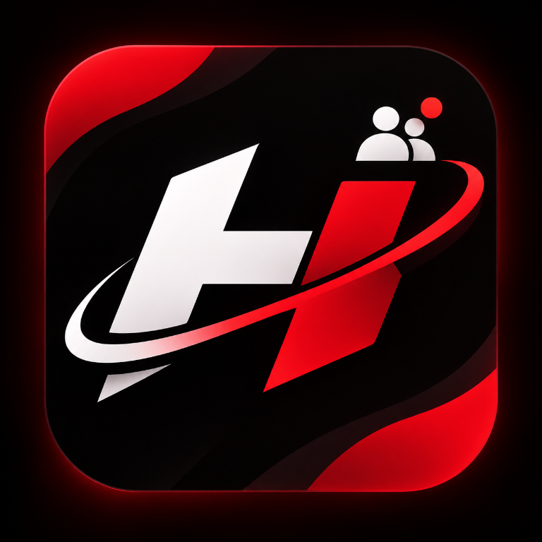

<div align="center">
  
  <h1>HackLink</h1>
  <p><strong>Connect. Compete. Collaborate.</strong></p>
  <p>A community for Iloilo's developers, designers, students, and hackathon organizers.</p>
  <p>
    
    
    
    
  </p>
</div>

## About

HackLink helps the local hackathon community connect, share work, find Guilds, and discover events. Iloilo is the initial supported region; the allowed region list is maintained in [`src/config/regions.ts`](src/config/regions.ts).

The roadmap MVP includes email/password accounts, onboarding and an area-based waitlist, profiles, posts/comments/likes, connections, public and private Guilds, hackathon events and applications, organizer reviews/results, and in-app notifications. Data is persisted in PostgreSQL. The public welcome page uses illustrative sample cards, clearly labeled as sample content.

## Tech stack

| Area | Technology |
| --- | --- |
| Framework and routing | Next.js 16 App Router |
| UI | React 19 |
| Language | TypeScript 5.9 |
| Styling | Tailwind CSS 3.4 |
| Icons | Lucide React |
| Fonts | Inter, Space Grotesk, and JetBrains Mono (self-hosted with `next/font`) |
| Authentication | Auth.js Credentials provider |
| Database and ORM | PostgreSQL (Neon) and Prisma 7 |
| Password hashing and validation | bcryptjs and Zod |
| Tests | Vitest |
| Sample seed runner | tsx |

## Getting started

**Requirements:** Node.js 20.9 or newer and npm.

```powershell
git clone https://github.com/Mes-Folz/HackLink.git
Set-Location HackLink
npm install
Copy-Item .env.example .env.local
```

### Configure environment

Set these values in `.env.local` (never commit or paste secrets into chat):

| Variable | Value |
| --- | --- |
| `DATABASE_URL` | Neon pooled PostgreSQL connection string for app requests |
| `DATABASE_URL_UNPOOLED` | Neon direct/unpooled connection string for Prisma migrations |
| `AUTH_SECRET` | A new random secret for Auth.js |
| `NEXTAUTH_URL` | `http://localhost:3000` for local development |
| `RESEND_API_KEY` | Server-side Resend API key used to send email verification links |
| `EMAIL_FROM` | Sender address verified with Resend (for example, `HackLink <noreply@your-domain>`) |
| `SAMPLE_SEED` | Keep `false` unless intentionally adding sample records to a local/staging database |

Use a database-scoped, non-admin read/write role for the pooled `DATABASE_URL`; keep the owner’s direct/unpooled URL in `DATABASE_URL_UNPOOLED` only for migrations. The configured Neon runtime role is `hacklink_app`. If the Neon CLI is authenticated in this terminal, `neon env pull` can populate the owner URLs, but preserve the restricted runtime URL in `DATABASE_URL` afterward. Do not send either URL to anyone; they contain credentials.

Generate `AUTH_SECRET` in PowerShell:

```powershell
node -e "console.log(require('crypto').randomBytes(32).toString('base64'))"
```

Paste the generated value only into `.env.local`.

Create a Resend account, verify a sender domain/address, and set `RESEND_API_KEY` and `EMAIL_FROM` in `.env.local` to enable registration. Never prefix the key with `NEXT_PUBLIC_` or commit it. Registration asks for an email and an 18+ self-declaration (no birthdate is collected); the confirmation date is stored with the account, and the mailbox owner chooses a password after opening the one-time verification link. This is not formal age verification. Under-18 signup and waitlist entries are paused until guardian-consent and child-privacy safeguards are implemented and reviewed.

Apply the schema and run the app:

```powershell
npm run db:deploy
npm run dev
```

The production build and automated checks do not prove a Neon connection. The production email-verification/rate-limit migration is already applied; the new age-attestation migration is still pending. Review it and run `npm run db:deploy` with the configured `.env.local` before deploying this age-gate change. This does not apply the migration automatically.

Open [http://localhost:3000](http://localhost:3000), create an account, and complete onboarding. The app requires a supported region and approximate area; it does not request GPS or an exact address. People outside the supported regions can join the waitlist.

For local schema development, use `npm run db:migrate`. Production deployment should use `npm run db:deploy` after the reviewed migration is present.

## Optional sample data

The sample seed creates clearly prefixed `SAMPLE` profiles, posts, a Guild, an event with an application and result record, and related demo activity. The `.invalid` email addresses cannot receive mail, and their random password hashes mean they are not demo login accounts.

Only run it against a local or staging database:

```powershell
# Set SAMPLE_SEED=true in .env.local for this run, then set it back to false.
npm run db:seed
```

The seed refuses to run in `NODE_ENV=production` and requires the explicit `SAMPLE_SEED=true` opt-in. Never enable it against the production database.

## Checks

```powershell
npm test
npm run build
npm audit --omit=dev
```

## Product and security rules

- Location is a self-declared area, not GPS tracking. Public profiles expose only the approximate area.
- The age gate is a self-declaration, not formal verification. Under-18 accounts are paused; do not enable them until guardian consent, private-by-default child accounts, child-friendly privacy information, and legal review are complete.
- Pending event applications reserve capacity. A rejection releases the place; registration is transactionally serialized to prevent overbooking.
- Only a host Guild's owner/admin or an assigned event organizer may manage applications and results.
- Private Guild details are queried only for members. Guild ownership must be transferred before an owner can leave.
- Server actions validate input and enforce authorization. User content is rendered as escaped text, not HTML.
- Uploads, email verification, password reset, chat, recruitment posts, advanced portfolios, rankings, and recommendations are not in this roadmap MVP.
- No analytics, tracking scripts, or embedded third-party widgets are configured. Auth.js session/CSRF cookies are essential; web fonts are served from the app after build.

## Project structure

```text
src/
  app/            Next.js routes and server-rendered pages
  components/     Shell, forms, feed, Guild, and event UI
  config/         Allowed regions and explicitly illustrative landing-page content
  server/         Authentication, validation, authorization, and domain actions
prisma/           PostgreSQL schema, migrations, and guarded sample seed
public/           Static assets, including the app icon
```
